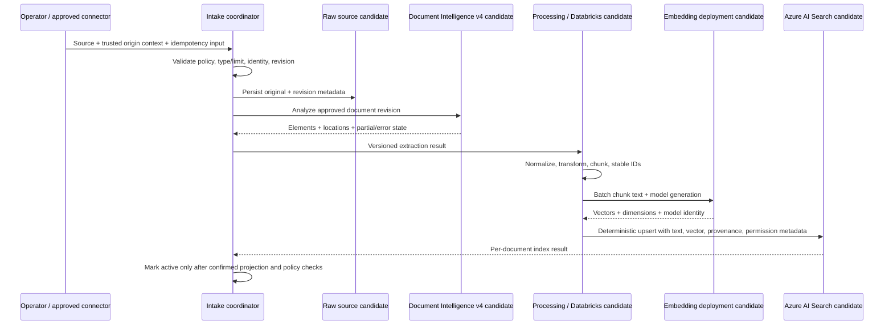

# Data Flow Architecture

**Status**: Proposed lifecycle; exact event source, storage layout, and permission synchronization remain pending.

**Query flow**: authenticated caller -> trusted principal resolution -> mandatory permission filter/token policy -> hybrid BM25/vector search -> bounded authorized context with source references -> chat model -> answer or abstention -> citations rechecked against current authorization -> response.

**Update/delete flow**: notification triggers lookup; coordinator compares current authoritative revision/permission state; processing generation is idempotent; old active search records are superseded only after replacement is safe; deletion removes all in-scope derived data unless a policy/legal hold requires a documented retained state. Reconciliation catches delayed, duplicated, or missed events.

**Failure boundaries**: extraction may partially succeed; embedding and search may throttle or return partial batch errors; network timeouts may hide whether writes committed. Record stage state and reconcile by deterministic identity before retry. Never advance active source revision based on event arrival alone.