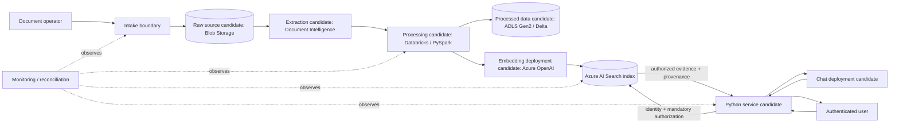

# Architecture Overview

**Status**: Proposed reference architecture; not approved for implementation.

The candidate flow separates source of truth, processing, retrieval, generation, and operations. Candidate services are Azure Blob Storage, Azure AI Document Intelligence v4, Azure Databricks/PySpark with Unity Catalog, Azure OpenAI, Azure AI Search, and a Python service. Product, security, and workload decisions remain prerequisites to acceptance.

The index is derived and rebuildable. Authorization must be applied before evidence reaches the model and before citations or snippets reach the caller. Events trigger work; durable source revision, idempotency state, and reconciliation determine the active result. See [system architecture](system-architecture.md), [data flow](data-flow.md), and [open questions](../project-management/open-questions.md).