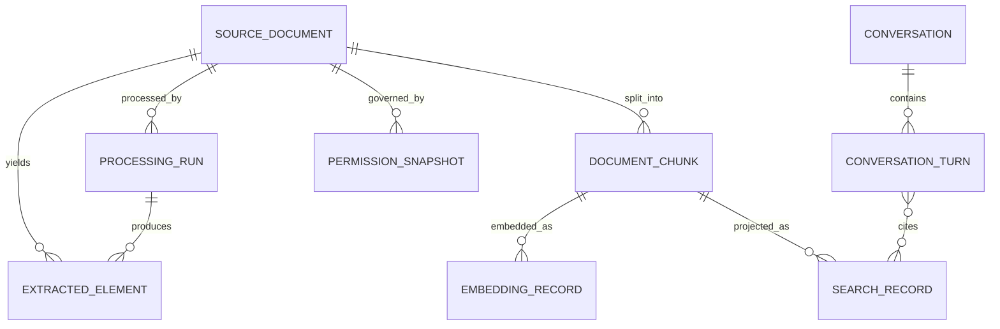

# Proposed Data Model

**Status**: Proposed conceptual contract, not an approved physical schema. Fields required for access policy, tenant identity beyond the confirmed single-organization boundary, classification, and retention need owner decisions. Search records are derived and rebuildable unless a policy states otherwise.

## Entities

| Entity | Purpose | Proposed attributes and invariants |
|---|---|---|
| SourceDocument | Stable logical identity for an uploaded or connected source | `document_id` (stable opaque ID); `source_uri` or origin reference (access controlled); `source_revision` (provider version/ETag or content digest plus observed time); `media_type`; `original_name`; `size_bytes`; `lifecycle_state`; `classification` (pending policy); `permission_reference` (authority pending); created/updated timestamps. Never use a mutable filename alone as identity. |
| ProcessingRun | Idempotent record of one processing attempt | `run_id`; `document_id`; `source_revision`; `pipeline_version`; stage status/timestamps; retry parent; error category/reference; correlation ID; observed content checksum. One run per idempotency key and pipeline version unless an explicit reprocess is requested. |
| ExtractedElement | Provenanced output from document extraction | `element_id`; document/revision/run references; element type (`text`, `table`, `key_value`, `heading`, `layout`, `other`); content/structured payload; page/sheet/slide and bounding region when returned; confidence where supplied; extractor model/API version. Partial or absent element types must be represented explicitly. |
| DocumentChunk | Unit supplied to embedding and retrieval | `chunk_id`; document/revision references; stable chunking version; ordinal; content; source-location references; metadata; access-policy reference; content digest. Stable ID derived from document ID + source revision + chunking version + deterministic chunk key; exact algorithm pending benchmark. |
| EmbeddingRecord | Vector for one chunk/model configuration | `chunk_id`; model/deployment identifier; model version; dimensions; input digest; vector; creation timestamp. Changing model or dimensions creates a new embedding generation; never mix spaces in one vector field. |
| SearchRecord | Search projection for one chunk revision | Search key; chunk/document/revision references; text and display metadata; vector field; filter fields; indexing state; schema/embedding version; permission metadata. Search key must be deterministic and unique per chunk/model-generation where coexisting generations are needed. |
| Conversation | Identity-bound conversational session | `conversation_id`; authenticated principal reference; organization scope; creation/expiry; retention state; state version. Storage and expiry are pending decisions. |
| ConversationTurn | User question and system response | `turn_id`; conversation ID; request/response timestamps; query; answer; retrieved citation references; model and prompt versions; answer status (grounded, insufficient evidence, dependency failure). Content persistence requires data policy approval. |
| PermissionSnapshot | Authorization data used during retrieval | `document_id`/revision; authority and permission scheme; principal/group/scope identifiers or token-evaluated metadata; synchronization time/version. Values are sensitive and must not be retrievable in public search output. Actual source and freshness policy are pending. |

## Relationships and Lifecycle

Source revision progression is append-observable: `accepted -> processing -> extracted -> transformed -> embedded -> indexed -> active`; failure states include `retryable_failure`, `terminal_failure`, and `superseded`. Deletion is a separate requested/approved state and must propagate to chunks, vectors, index projections, caches, and conversation references in scope. Legal holds or retention exceptions require an explicit policy state. This lifecycle is proposed and must be reconciled with product/security policy.

## Identity, Uniqueness, and Reprocessing

- Logical document identity must be independent of filename and path renames where the source connector can provide a stable ID.
- Source revision must distinguish content changes. Preferred source version/ETag is connector-dependent; content digest is a fallback candidate, not an approved source system.
- Chunk identity should be deterministic for a fixed source revision and chunking version. A model change does not change document/chunk identity; it creates a new embedding generation.
- Processing stages must be replayable from durable source/intermediate state. Index updates should use deterministic keys and idempotent upsert/delete operations.
- Events are triggers only. A durable checkpoint/reconciliation process is required for lost, duplicate, delayed, or out-of-order notifications.
- Search authorization metadata must be applied to every chunk and checked before any text, snippet, citation, or generated answer is exposed.

## Validation Rules

- No chunk or embedding can be active without a source revision, processing version, and provenance reference.
- Vector dimensions must match the approved model output and the Azure AI Search vector field definition exactly.
- Permission metadata may not be omitted silently: missing/expired metadata fails closed for protected content.
- Deletion and retention states must be auditable and consistent across authoritative storage, processed data, index, conversation state, and backups according to approved policy.
- Sensitive payloads and identifiers require data classification and access rules before logs or traces include them.

## Decisions Required

Stable source ID provider, revision semantics, source format and file limits, table representation, chunking boundaries, access policy authority, permission freshness, retention/deletion semantics, classification, conversation persistence, and embedding/index generation coexistence remain open. See [open questions](../../docs/project-management/open-questions.md) and [ADRs](../../docs/architecture/architecture-decisions.md).